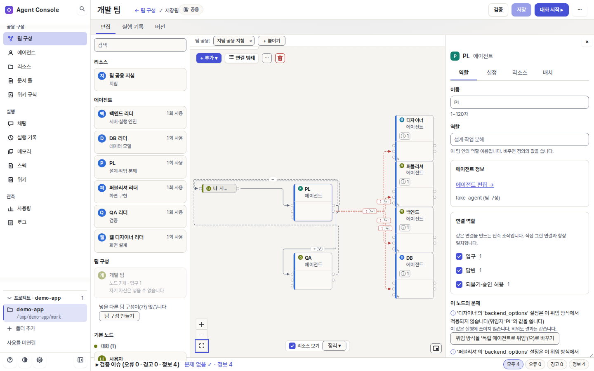
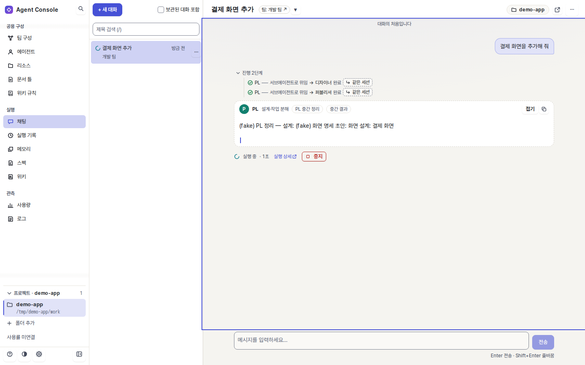
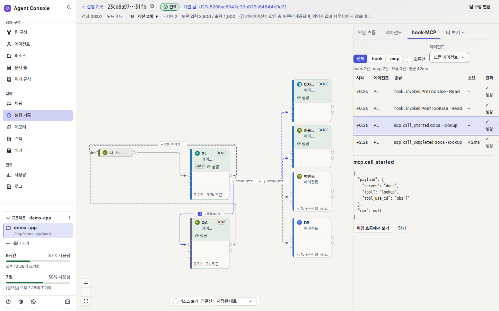
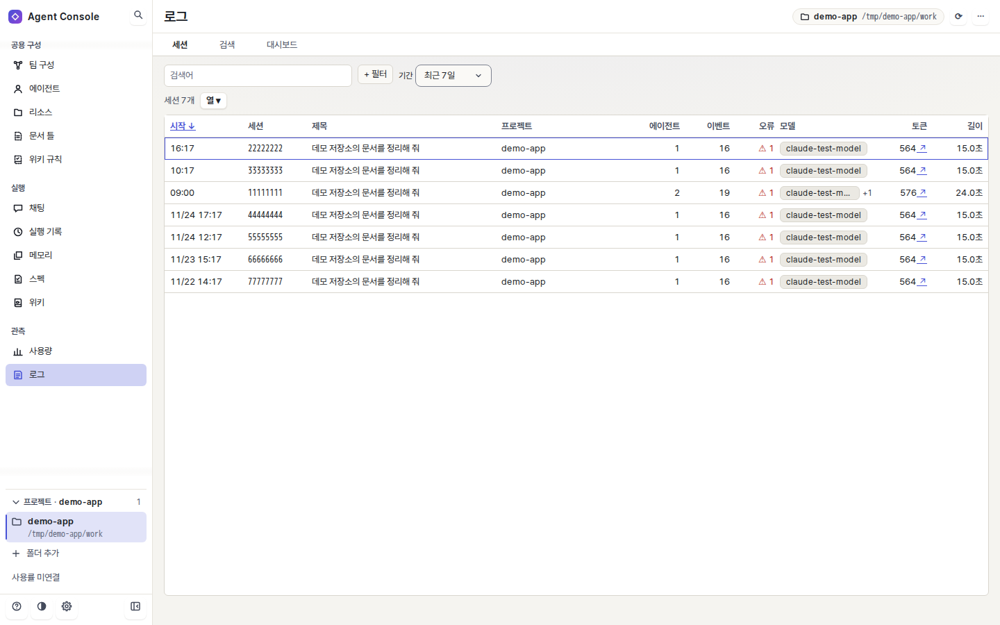
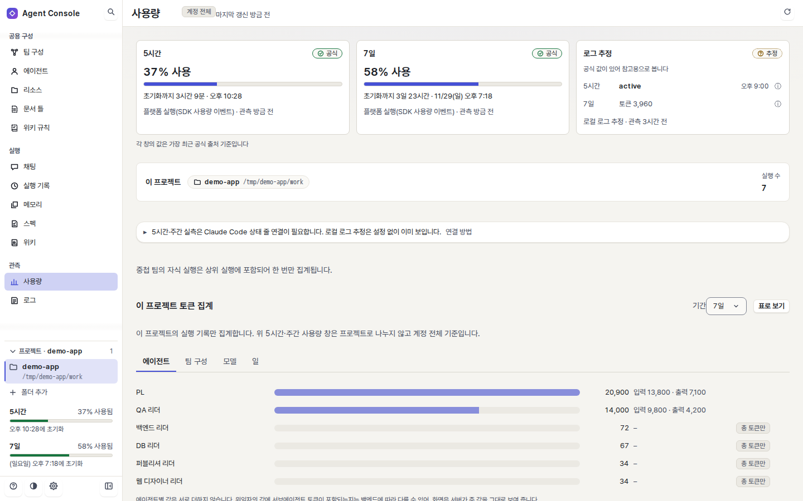

# Agent Console

[](https://github.com/jjjuuuun/agent-console/actions/workflows/ci.yml)

[English](README.md) | **한국어**

에이전트 팀을 직접 구성해서 채팅으로 일을 맡기는 로컬 웹 플랫폼입니다. 에이전트, 팀, 라우팅, 그래프, 로그 출처, 위키 규칙은
모두 코드에 고정된 목록이 아니라 사용자가 만드는 데이터입니다.

## Agent Console이란

Agent Console은 내 컴퓨터에서 Python 서버와 React 웹 앱으로 돌아갑니다. 웹에서 에이전트를 만들고, 그래프 편집기로 이어 팀을
구성한 뒤, 채팅으로 팀에 일을 맡깁니다. 실행 과정(위임, hook, MCP 도구 호출), 사용량, 세션 로그도 같은 화면에서 봅니다.

미리 깔리는 것은 없습니다. 기본 팀, 역할, 분류도 없습니다. "종류"에 해당하는 것(노드 종류, 연결 종류, 실행 백엔드, 로그 출처,
가져오기·내보내기 형식)은 모두 확장 지점에 등록됩니다. 설정만으로 부족하면 서버나 웹 코드를 고치지 않고 플러그인 패키지를
더합니다.

## 주요 기능

- **에이전트**: 이름, 지시문, 실행 백엔드, 모델, 도구, 리소스. 화면에서 고치거나 작업 공간의 YAML 파일로 고칩니다.
- **팀 그래프**: 에이전트를 묶는 그래프 편집기. 조건, 에이전트 사이 위임, 실행 중 사용자에게 되묻기와 승인을 지원합니다.
- **채팅**: 팀을 골라 일을 맡깁니다. 메시지 하나가 실행 하나이고, 에이전트는 일하는 중에 사용자에게 입력을 요청할 수 있습니다.
- **실행 기록과 추적**: 실행 목록과 상세 화면. 위임 흐름, hook 이벤트, MCP 도구 호출, 소요 시간, 오류를 봅니다.
- **사용량**: 5시간·주간 사용량 창과 토큰 합계를 여러 출처(실행, 세션 로그, Claude Code 상태 줄 브리지)에서 모읍니다.
- **로그**: 등록한 프로젝트 폴더의 Claude Code 세션 로그를 모아 검색, 타임라인, 대시보드로 봅니다. 분류 규칙도 데이터라 바꾸거나
  끌 수 있습니다.
- **프로젝트**: 로컬 폴더를 등록합니다. 대화, 실행, 로그, 메모리, 위키, 스펙은 프로젝트별로 나뉩니다. 구성은 공용 라이브러리에
  두고 프로젝트가 복사해 씁니다.
- **위키, 메모리, 스펙**: 링크 그래프와 규칙 점검이 있는 프로젝트 위키, 에이전트가 읽고 쓰는 공유 메모리, 작업 추적이 되는 스펙
  문서. 모두 사용자가 정한 틀과 규칙으로 동작합니다.
- **가져오기·내보내기**: 프로젝트의 `.claude/` 폴더에서 에이전트와 설정을 복사해 오고, zip 파일이나 Claude Code 폴더 구조로
  내보냅니다. 모든 정의의 버전을 남겨 되돌릴 수 있습니다.
- **모듈식 서버**: 백엔드 기능(채팅, 실행, 사용량, 로그, 정의, 가져오기·내보내기 …)은 각각 서버 모듈이고 따로 켜고 끕니다.
  웹은 켜진 모듈만 보여 줍니다.
- **화면 언어**: 영어·한국어 화면. 문구 묶음 파일로 언어를 더하거나 문구를 바꿉니다.

## 스크린샷



| | |
| --- | --- |
|  |  |
|  |  |

## 준비물

- Python 3.12 이상(최신 보안 패치 권장)
- [uv](https://docs.astral.sh/uv/getting-started/installation/) 0.13.4 이상
- Node.js `^22.23.4 || ^24.22.1 || >=26.12.1`
- pnpm 10.34.5 이상(`corepack enable`을 켜면 `package.json`에 고정한 버전을 씁니다)

써 보는 데 Claude 계정은 필요 없습니다. 기본으로 들어 있는 `fake-agent` 백엔드는 모델을 호출하지 않습니다.

## 빠른 시작

```bash
git clone https://github.com/jjjuuuun/agent-console.git
cd agent-console
uv sync --all-packages
pnpm install
```

**방법 1: 프로세스 하나.** 웹을 한 번 빌드하면 서버 하나가 API와 웹 화면을 함께 제공합니다.

```bash
pnpm --filter @agent-console/web build    # 처음 한 번, 코드를 새로 받을 때마다
AGENT_CONSOLE_SERVE_STATIC=1 AGENT_CONSOLE_WEB_DIR=apps/web/dist uv run agent-console serve --open
```

`--open`을 붙이면 서버가 준비된 뒤 `http://localhost:8765/`를 브라우저로 엽니다. 빼면 주소를 직접 엽니다. Windows에서 쓰거나
옵션을 고정하려면 `agent-console.yaml`에 적고 `uv run agent-console serve`로 실행합니다.

```yaml
web:
  serve_static: true
  static_dir: apps/web/dist
  open: {enabled: true}
```

**방법 2: `pnpm app`.** 서버와 웹 미리보기를 함께 띄웁니다. 웹 빌드가 없으면 먼저 빌드합니다.

```bash
pnpm app                                  # 서버 http://127.0.0.1:8765, 웹 http://127.0.0.1:4173
pnpm app --build                          # 웹을 다시 빌드한 뒤 실행
pnpm app -- --disable-module mod-exports  # `--` 뒤는 `agent-console serve` 인자
```

`pnpm app`은 개발용 실행기이고, 화면에 `fake-agent` 백엔드도 보여 줍니다.

어느 방법이든 서버는 `127.0.0.1`에서만 접속을 받습니다. 다른 주소는 `security.allow_remote: true`가 있어야 합니다.
`GET /api/v1/health`가 200이면 준비된 것입니다. 종료는 Ctrl-C입니다. 서버 옵션 전체는 `uv run agent-console serve --help`로
봅니다.

## 처음 쓰기

서버는 빈 작업 공간으로 시작합니다. 미리 들어 있는 에이전트나 팀은 없습니다.

1. **에이전트를 만듭니다**(이름, 지시문, 백엔드, 모델). 모델 호출 없이 써 보려면 `fake-agent` 백엔드를 고릅니다. 기본으로
   숨겨져 있으며, `pnpm app`은 보이게 띄우고, 그 밖에는 `AGENT_CONSOLE_SHOW_HIDDEN_BACKENDS=1`
   (설정 `modules.options.mod-runs.show_hidden_backends: true`)로 보이게 합니다.
2. **팀을 만듭니다.** 그래프에 에이전트 노드를 놓고 연결합니다. 에이전트 하나만 있는 팀도 됩니다.
3. **채팅**에서 팀을 골라 일을 맡깁니다. 실행 기록, 사용량, 로그는 각자 화면이 있습니다.

**실제 Claude 모델 쓰기.** *설정 › 에이전트 기본값*에서 백엔드를 `claude-agent-sdk`로 바꿉니다. 기본 인증은 Claude 구독
로그인입니다. 로그인은 **백엔드 연결** 대화상자(사이드바 맨 아래 플러그 아이콘)나 같은 설정 화면의 백엔드 상태 카드에서 합니다.
자격은 앱 전용 폴더(`<workspace>/.state/claude`)에 두며, 앱은 토큰을 받거나 저장하지 않습니다. 로그인하면 모델 칸에 이 계정에서
쓸 수 있는 모델이 나옵니다(모델을 호출하지 않습니다). 모델 id는 코드에 들어 있지 않으며, 이름을 바꾸거나 목록을 직접 정하려면
`modules.options.mod-runs.backends.claude-agent-sdk.models`에 적습니다. Anthropic 문서는 Agent SDK 기반 앱에 API 키 사용을
안내하므로, 구독 자격을 쓰기 전에 약관을 직접 확인하세요. API 키를 쓰려면 키를 환경변수에 두고 설정에서는
`secret://anthropic_api_key`로 참조합니다. 자세한 순서는 [USAGE.ko.md](USAGE.ko.md)에 있습니다.

**Claude Code를 이미 쓰고 있다면** 프로젝트 폴더를 등록하고 그 `.claude/`의 에이전트와 설정을 가져옵니다. 원본 파일은 읽기만
합니다. `~/.claude` 아래 전역 구성은 가져오지 않습니다.

## 구성

| 무엇 | 어디 |
| --- | --- |
| 서버 설정 | `agent-console.yaml`. `--config` → `AGENT_CONSOLE_CONFIG` → 현재 폴더 순으로 찾습니다. `agent-console.example.yaml`을 복사해 시작합니다. 우선순위: 명령행 > `AGENT_CONSOLE_*` 환경변수 > 파일 > 기본값 |
| 작업 공간 | 기본 `.agent-console/`(설정 `workspace` 또는 `--workspace`). 정의(에이전트, 팀, 리소스, `settings.yaml`)를 YAML로 둡니다. 실행 상태(SQLite DB, 앱 로그인 자격, 사용량 브리지 파일)는 `<workspace>/.state/` 아래에 둡니다 |
| 프로젝트 폴더 | 화면에서 만들거나 등록합니다. 앱은 등록한 폴더와 자기 작업 공간 안에서만 동작합니다. 프로젝트마다 구성 사본을 `<folder>/.agent-console/`에 둡니다. 프로젝트를 지우면 등록만 해제되고 폴더 내용은 지우지 않습니다 |
| 기능 모듈 | `modules.enabled`·`modules.disabled` 또는 `--enable-module`·`--disable-module`. 모듈 설정은 `modules.options.<모듈 id>` 아래에 둡니다. 모듈 목록과 상태는 `GET /api/v1/modules` |
| 화면 언어 | *설정 › 화면 › 언어*(영어·한국어, 기본은 브라우저 언어를 따름). 코드를 고치지 않고 문구를 바꾸거나 언어를 더하려면 `<언어>.json` 문구 묶음을 폴더에 두고 그 폴더를 `modules.options.mod-i18n.catalog_dirs`에 적습니다. 사용 안내의 [화면 언어](USAGE.ko.md#화면-언어) 참고 |

설정 파일의 상대 경로는 그 파일이 있는 폴더 기준입니다. 모르는 키나 지운 키가 있으면 서버는 시작하지 않고 무엇을 고쳐야 하는지
알려 줍니다. 전체 키는 [apps/server/README.md](apps/server/README.md)에 있습니다.

비밀 값은 파일에 적지 않습니다. 환경변수에 두고 `secret://<이름>`으로 참조합니다.

## 확장

새 종류는 서버나 웹 코드를 고치지 않고 플러그인 패키지로 더합니다. 설치한 패키지는 Python entry point로 등록되고,
`plugins.disabled`로 하나씩 끌 수 있습니다.

확장 지점에는 노드 종류, 연결 종류, 조건 연산자, 실행 백엔드, 위임 방식, 상호작용 종류, 로그 출처와 분류기, 사용량 출처,
가져오기 출처, 내보내기 형식, 리소스 종류, 비밀 값 공급자, 메모리 범위, 위키 검사, 문구 묶음(다른 언어의 화면 문구), 서버 모듈
전체가 있습니다. 백엔드는 계정의 모델 목록을 알려 주는 능력도 더할 수 있습니다. 웹 쪽에는 설정 폼 위젯과 대시보드 위젯이 있습니다.

- [확장 가이드](docs/extending/README.md): 바꾸려는 것에 맞는 확장 지점 고르기, 플러그인 만들기·테스트·배포
- [예제 플러그인](examples/extensions/README.md): 확장 지점마다 작은 패키지 하나, 각각 설치·제거 명령 포함

```bash
uv pip install -e examples/extensions/agent-console-example-condition   # 설치 후 서버를 다시 시작
```

## 문서

- [USAGE.ko.md](USAGE.ko.md): 사용 안내([영어](USAGE.md))
- [CHANGELOG.md](CHANGELOG.md): 릴리스 노트(영어)
- [docs/extending/](docs/extending/README.md): 확장 가이드(영어)
- [apps/server/README.md](apps/server/README.md): 서버 설정, REST, WebSocket(영어)
- [apps/cli/README.md](apps/cli/README.md): `agent-console` 명령(`serve`, `statusline`, `logs purge`)(영어)
- [docs/DEVELOPMENT.ko.md](docs/DEVELOPMENT.ko.md): Claude Code로 이 프로젝트를 개발한 방식([영어](docs/DEVELOPMENT.md))
- `packages/`와 `apps/` 아래 패키지마다 API와 설정을 적은 README(영어)가 있습니다

## 알려진 한계

자동 검사는 fake 백엔드로 돕니다. 실제 Claude Agent SDK 실행, 실제 계정의 모델 조회, 일부 플랫폼 조합(Windows 파일 시스템
특성, OS 폴더 선택 창, 한국어 입력기, FTS5가 없는 SQLite, 아주 큰 위키, 루프백이 아닌 주소 바인딩)은 자동 검사 범위 밖이므로
쓰는 환경에서 직접 확인하세요. 모델 목록은 백엔드 상태 카드가 점검하는 인증과 설치된 Claude Code CLI가 알려 주는 목록을
따릅니다. 구독 자격을 Agent SDK에 쓰는 것이 약관상 허용되는지는 확인되지 않았으므로 약관을 직접 확인하고 본인 책임으로
쓰세요. 번역되는 것은 앱 문구뿐입니다. 사용자가 쓴 이름·지시문 같은 데이터, 에이전트 출력, 로그 원문, 문구 묶음을 주지 않는
확장의 문구는 쓰인 그대로 보입니다. 패키지는 PyPI나 npm에 올리지 않았으므로 소스에서 설치합니다. 자세한 내용은
[CHANGELOG.md](CHANGELOG.md)에 있습니다.

## 기여

기여를 환영합니다. 개발 환경, 검사, 커밋 메시지 형식, 패키지 규칙은 [CONTRIBUTING.md](CONTRIBUTING.md)(영어)를 보세요.

## 라이선스

[MIT](LICENSE)
