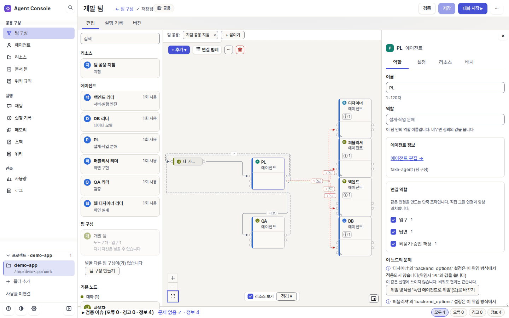
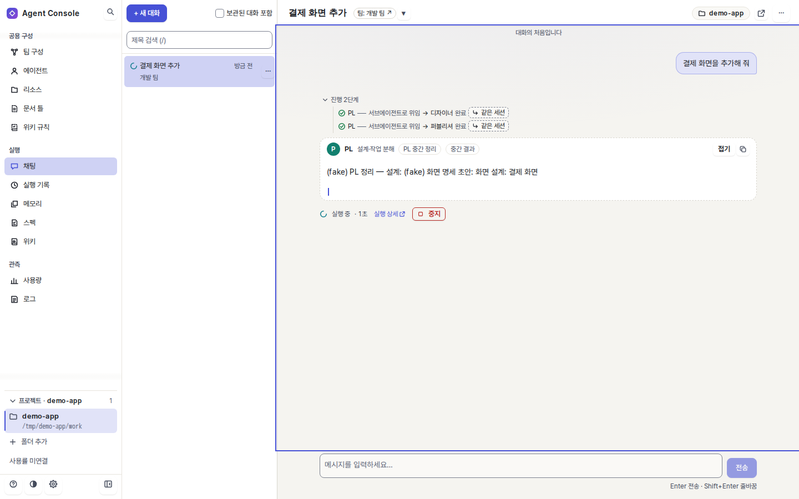
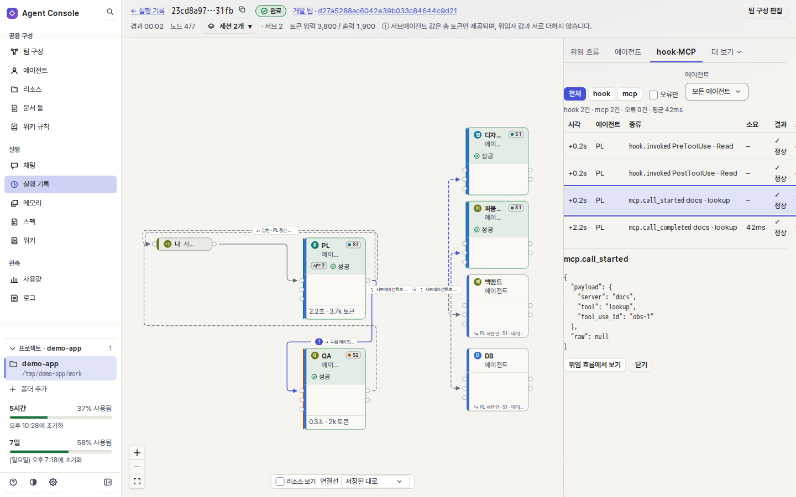
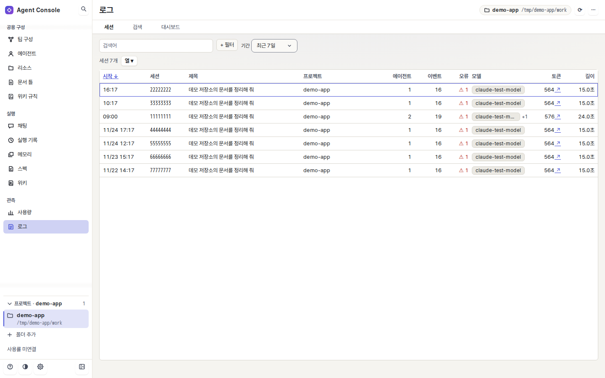
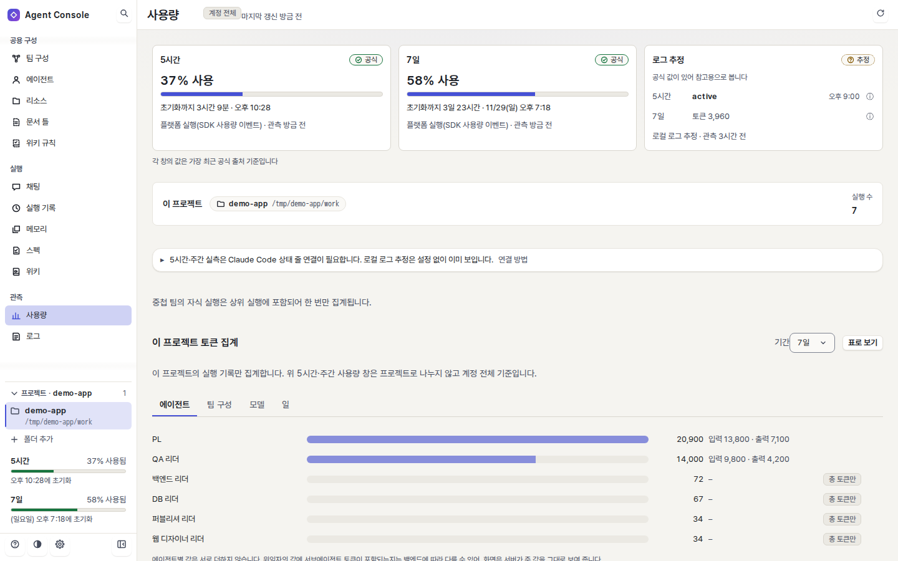

# Agent Console

[](https://github.com/jjjuuuun/agent-console/actions/workflows/ci.yml)

**English** | [한국어](README.ko.md)

A local web platform where you build your own agent teams and hand them work through chat. Agents, teams, routing,
graphs, log sources and wiki rules are all your data, not hard-coded lists.

## What is Agent Console?

Agent Console runs on your machine: a Python server and a React web app. In the web app you create agents, connect them
into a team on a graph editor, and give the team work in a chat. You can then follow each run (delegation, hooks, MCP
tool calls), check usage, and read session logs on the same screen.

Nothing comes pre-installed. There are no built-in teams, roles or categories. Anything that looks like a "type"
(node types, edge types, execution backends, log sources, import and export formats) is registered through an
extension point. If a setting is not enough, you add a plugin package instead of changing the server or web code.

## Features

- **Agents**: name, instructions, execution backend, model, tools and resources. Edit them in the UI or as YAML files
  in your workspace.
- **Team graphs**: a visual graph editor for putting agents together, with conditions, delegation between agents, and
  questions or approvals that go back to you during a run.
- **Chat**: pick a team and send it a task. Each message starts a run, and agents can ask you for input while they work.
- **Runs and tracing**: run history and run detail, including the delegation flow, hook events, MCP tool calls,
  timing and errors.
- **Usage**: 5-hour and weekly usage windows and token totals from several sources (runs, session logs, and a bridge
  for the Claude Code status line).
- **Logs**: collects Claude Code session logs from the project folders you register, with search, timelines and
  dashboards. The classification rules are data you can change or turn off.
- **Projects**: register local folders. Chats, runs, logs, memory, wiki and specs are kept per project. Configuration
  lives in a shared library that projects copy from.
- **Wiki, memory and specs**: a project wiki with a link graph and rule checks, shared memory that agents can read and
  write, and spec documents with task tracking, all driven by templates and rules you define.
- **Import and export**: copy agents and settings from a project's `.claude/` folder, export to a zip file or a Claude
  Code folder layout, and keep versions of every definition so you can restore them.
- **Modular server**: each backend feature (chat, runs, usage, logs, definitions, import and export, ...) is a server
  module that you can turn on or off. The web app only shows modules that are on.

## Screenshots



| | |
| --- | --- |
|  |  |
|  |  |

## Requirements

- Python 3.12 or later (latest security patch recommended)
- [uv](https://docs.astral.sh/uv/getting-started/installation/) 0.13.4 or later
- Node.js `^22.23.4 || ^24.22.1 || >=26.12.1`
- pnpm 10.34.5 or later (`corepack enable` uses the version pinned in `package.json`)

You do not need a Claude account to try it out. The built-in `fake-agent` backend runs without any model calls.

## Quick start

```bash
git clone https://github.com/jjjuuuun/agent-console.git
cd agent-console
uv sync --all-packages
pnpm install
```

**Option 1: one process.** Build the web app once, and the server serves both the API and the web UI:

```bash
pnpm --filter @agent-console/web build    # first time, and after every pull
AGENT_CONSOLE_SERVE_STATIC=1 AGENT_CONSOLE_WEB_DIR=apps/web/dist uv run agent-console serve --open
```

`--open` opens `http://localhost:8765/` in your browser once the server is ready. Without it, open the address
yourself. On Windows, or to keep these options, put them in `agent-console.yaml` and run
`uv run agent-console serve` instead:

```yaml
web:
  serve_static: true
  static_dir: apps/web/dist
  open: {enabled: true}
```

**Option 2: `pnpm app`.** Starts the server and a web preview together, building the web app first if needed:

```bash
pnpm app                                  # server http://127.0.0.1:8765, web http://127.0.0.1:4173
pnpm app --build                          # rebuild the web app first
pnpm app -- --disable-module mod-exports  # arguments after `--` go to `agent-console serve`
```

`pnpm app` is meant for development. It also shows the `fake-agent` backend in the UI.

Either way, the server listens on `127.0.0.1` only. Other addresses need `security.allow_remote: true`. The server is
ready when `GET /api/v1/health` returns 200. Press Ctrl-C to stop. All server options are listed by
`uv run agent-console serve --help`.

## First steps

The server starts with an empty workspace. No agents or teams are installed in advance.

1. **Create an agent** (name, instructions, backend, model). To try things without model calls, use the `fake-agent`
   backend. It is hidden by default. `pnpm app` shows it, or set `AGENT_CONSOLE_SHOW_HIDDEN_BACKENDS=1`
   (setting: `modules.options.mod-runs.show_hidden_backends: true`).
2. **Create a team.** Place agent nodes on the graph and connect them. A team with a single agent is fine.
3. **Open Chat**, pick the team and send a task. Runs, usage and logs each have their own page.

**Using real Claude models.** Switch the backend to `claude-agent-sdk` in *Settings › Agent defaults*. Model ids are not
built in. List the ones you want under `modules.options.mod-runs.backends.claude-agent-sdk.models`. By default the
backend signs in with your Claude subscription. The sign-in happens on the backend status card inside the app, the
credentials are kept in an app-only folder (`<workspace>/.state/claude`), and the app never receives or stores the
token. Anthropic's documentation recommends API keys for apps built on the Agent SDK, so check the terms yourself
before using subscription credentials. To use an API key instead, keep the key in an environment variable and refer
to it as `secret://anthropic_api_key`. The full steps are in [USAGE.md](USAGE.md).

**Already using Claude Code?** Register the project folder and import its `.claude/` agents and settings. The
original files are only read. Global configuration under `~/.claude` is not imported.

## Configuration

| What | Where |
| --- | --- |
| Server settings | `agent-console.yaml`. The server looks at `--config`, then `AGENT_CONSOLE_CONFIG`, then the current folder. Start from `agent-console.example.yaml`. Precedence: command line > `AGENT_CONSOLE_*` environment variables > file > defaults |
| Workspace | Default `.agent-console/` (setting `workspace`, or `--workspace`). Holds your definitions as YAML (agents, teams, resources, `settings.yaml`). Runtime state (SQLite database, app sign-in, usage bridge file) is kept under `<workspace>/.state/` |
| Project folders | Created or registered from the UI. The app only works inside registered folders and its own workspace. Each project keeps its copy of the configuration in `<folder>/.agent-console/`. Removing a project only unregisters it, and nothing in the folder is deleted |
| Feature modules | `modules.enabled` / `modules.disabled`, or `--enable-module` / `--disable-module`. Module settings go under `modules.options.<module id>`. `GET /api/v1/modules` lists the modules and their state |

Relative paths in the settings file are resolved against the folder that contains it. If the file has unknown or
removed keys, the server refuses to start and explains what to change. The full key reference is in
[apps/server/README.md](apps/server/README.md).

Keep secrets out of files. Put them in environment variables and refer to them with `secret://<name>`.

## Extending

New kinds of things are added as plugin packages, without changing the server or web code. Installed packages
register through Python entry points, and each one can be turned off with `plugins.disabled`.

Extension points include node types, edge types, condition operators, execution backends, delegation strategies,
interaction kinds, log sources and classifiers, usage sources, import sources, export formats, resource types,
secret providers, memory scopes, wiki checks, and whole server modules. On the web side there are settings form
widgets and dashboard widgets.

- [Extension guide](docs/extending/README.md): which extension point fits your change, and how to build, test and ship a
  plugin
- [Example plugins](examples/extensions/README.md): one small package per extension point, each with install and
  remove commands

```bash
uv pip install -e examples/extensions/agent-console-example-condition   # then restart the server
```

## Documentation

- [USAGE.md](USAGE.md): user guide (Korean)
- [CHANGELOG.md](CHANGELOG.md): release notes
- [docs/extending/](docs/extending/README.md): extension guide (Korean)
- [apps/server/README.md](apps/server/README.md): server settings, REST and WebSocket (Korean)
- [apps/cli/README.md](apps/cli/README.md): the `agent-console` command: `serve`, `statusline`, `logs purge` (Korean)
- [docs/DEVELOPMENT.md](docs/DEVELOPMENT.md): how this project was built with Claude Code (Korean)
- Each package under `packages/` and `apps/` has its own README with its API and settings

## Known limitations

Automated tests use the fake backend. Real Claude Agent SDK runs and some platform setups (Windows file system
details, the native folder picker, IME input, SQLite builds without FTS5, very large wikis, binding to non-loopback
addresses) are outside the automated tests, so check them in your own environment. The web UI and most documentation are in Korean for now. Packages are not
published to PyPI or npm, so install from source. See [CHANGELOG.md](CHANGELOG.md) for details.

## Contributing

Contributions are welcome. See [CONTRIBUTING.md](CONTRIBUTING.md) for the development setup, checks, commit message
format and package rules.

## License

[MIT](LICENSE)
